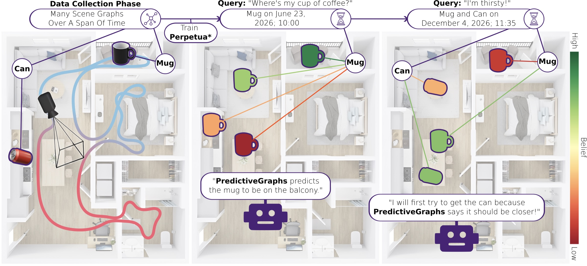

# Predictive Graphs

<p align="center">
  
</p>

Code for [Predictive Spatio-Temporal Scene Graphs for Semi-Static Scenes](https://montrealrobotics.ca/predictive-graphs/) (Predictive Graphs).

A Predictive Graph is an object map whose edges between small objects (pickupables) and the furniture they rest on (receptacles) are predicted over time by [Perpetua*](https://github.com/montrealrobotics/perpetua-star) estimators. A robot uses it to answer "where is this object likely to be now?" and to go and look for it. This repository contains:

- **A navigation demo** in the [SemiStaticSim](https://pypi.org/project/semistaticsim/) simulator (ProcTHOR houses rendered with AI2-THOR), running on a map and estimators that we provide.
- **Map building**: from posed RGB-D frames to an object map (segmentation, CLIP features, 3D fusion), then matching map objects to the scene's pickupables and receptacles and attaching their Perpetua* estimators.
- **Viewers** for the map and the agent, in the browser through [viser](https://viser.studio).

To create your own data and estimators instead of using ours, see [DATA.md](DATA.md).

## Installation

Requirements: Linux, an NVIDIA GPU, and [uv](https://docs.astral.sh/uv/getting-started/installation/).

```bash
git clone --recurse-submodules https://github.com/montrealrobotics/pred-graphs.git
cd pred-graphs
uv sync
```

This installs Predictive Graphs together with its two submodules, [`perpetua2`](https://github.com/montrealrobotics/perpetua-star) (Perpetua* estimators) and [`rgbd_dataset`](https://github.com/MikeS96/rgbd-dataset) (RGB-D data loading). Run every command below from the repository root.

The simulator renders with Vulkan, so it needs the Vulkan loader library (`libvulkan.so.1`) and an NVIDIA driver with Vulkan support. On Ubuntu or Debian:

```bash
sudo apt-get install libvulkan1
```

Alternatively, install the loader in a conda environment (`conda install -c conda-forge libvulkan-loader`) and add that environment's `lib` folder to `LD_LIBRARY_PATH`. 

## Example data

The demo uses one SemiStaticSim house (ProcTHOR layout 153), hosted on [Hugging Face](https://huggingface.co/datasets/Mycroft96/predictive-graphs-procthor-153). Download it and extract it into `data/`:

```bash
uv run hf download Mycroft96/predictive-graphs-procthor-153 --repo-type dataset --local-dir data/archives
tar -xzf data/archives/predictive-graphs-procthor-153-demo.tar.gz -C data
tar -xzf data/archives/predictive-graphs-procthor-153-rgbd.tar.gz -C data  # only needed to build a map
```

```
data/
├── semistaticsim/test/153/0/
│   ├── groundtruth/            # object schedules over 4 weeks (672 hours)
│   └── privileged/run_<hour>/  # simulator runs, one per hour; RGB-D for hours 485-504
├── estimators/scene_153/       # fitted Perpetua* estimators, one per pickupable
└── maps/scene_153/             # Predictive Graph built at hour 504
```

Paths are set in `conf/paths/default.yaml`. To keep the data somewhere else, pass `data_root=/path/to/data` to any command.

## Navigation demo

```bash
uv run python agent.py demo_queries=3
```

This starts the simulator at hour 524, loads the map built at hour 504 and runs three queries: for each, it picks an object, teleports the robot to a random pose, predicts where the object is now, navigates there and looks around. The log reports whether the agent found the object or reported it absent, and what the simulator says is true:

```
Demo query 1/3: looking for 'TeddyBear|surface|4|7'
Agent found it after 35 steps; the object is present in the scene.
```

Open http://localhost:8080 (forward port 8080 when running on a remote machine) to watch the map, the robot and its camera. When the queries are done the viewer stays open for interactive use: pick an object and a time to see the predicted receptacles, or send the robot to a receptacle. Run `uv run python agent.py` to start in interactive mode directly.

Useful options (see `conf/agent.yaml`):

| Option                      | Default      | Meaning                                                                        |
| --------------------------- | ------------ | ------------------------------------------------------------------------------ |
| `world_time`              | `524`      | Simulator hour to start at. Must be at least`map_time` (504) and at most 671 |
| `demo_queries`            | `0`        | Number of sampled queries to run before handing over to the viewer             |
| `do_update`               | `false`    | Update the map from observations and re-plan while navigating                  |
| `top_k`, `max_attempts` | `2`, `2` | Receptacle candidates per object and navigation attempts per object            |
| `obj_threshold`           | `0.2`      | Candidates with a lower predicted probability count as the object being absent |
| `seed`                    | `42`       | Seed for query sampling                                                        |

### Open-vocabulary queries (OpenAI)

The viewer also accepts natural-language requests such as "Please go find the apple". An LLM agent (`openai:gpt-5.2`) turns them into calls to the map: find the object, predict where it is, navigate there. This needs an OpenAI API key:

```bash
export OPENAI_API_KEY=...
uv run python agent.py
```

### Perception

By default the agent uses privileged perception: it reads which objects it sees from the simulator. To perceive objects from the camera images with SAM3 and CLIP instead:

```bash
uv run python agent.py inference/agent@agent=ProcTHORAgent demo_queries=3
```

SAM3 checkpoints are gated on Hugging Face. Request access at https://huggingface.co/facebook/sam3 and log in once with `uv run hf auth login`; the checkpoint is then downloaded on first use. CLIP (ViT-H-14) weights are downloaded to `data/cache` on first use.

## Map viewer

```bash
uv run python map_server.py
```

Opens the Predictive Graph at http://localhost:8080 without the simulator. Pick an object and a time to see the predicted edges, and toggle centroids, bounding boxes and labels. `map_path=...` selects another map; `server=ObjectMapServer` shows a plain object map (`map.pkl`, as written by `main.py`).

## Building a map

Building a Predictive Graph takes the RGB-D runs before the map time and the fitted estimators:

```bash
uv run python orchestrate.py keyframes=true
```

`orchestrate.py` starts at hour 504 and works back through earlier runs (at most `max_iterations`, 3 by default) until every pickupable and receptacle of the scene has been matched to a map object. For each run it calls:

1. `main.py`: builds an object map from the run's RGB-D frames. Segmentation is SAM3 by default; `segmentation_model=YoloMobileSAM` is faster (download [`mobile_sam.pt`](https://github.com/ultralytics/assets/releases/download/v8.2.0/mobile_sam.pt) to `data/cache` first) and `segmentation_model=GTProcthor` uses the simulator's segmentation.
2. `map_query.py`: matches map objects to the scene's pickupables and receptacles and attaches their Perpetua* estimators, writing `perpetua_map.pkl`.

The map is written to `data/outputs/scene_<layout>_.../`, and `data/outputs/latest_map` points to it. Use it in the demo with `map_path=data/outputs/latest_map`.

To build maps for several layouts, `scripts/build_maps.sh 153 <layout> ...` runs `orchestrate.py` for each and writes to `data/outputs/scene_<layout>/latest_map`; options after `--` are passed to `orchestrate.py`. On a SLURM cluster, `sbatch scripts/build_maps.sbatch <layout>` does the same for one layout (add your cluster's partition or account to the script).

`use_vlm_verification=true` verifies the matches with OpenAI `gpt-5.2` (needs `OPENAI_API_KEY`). Both options also work when calling `main.py` (`segmentation=...`) and `map_query.py` directly.

## Configuration

All scripts are configured with [Hydra](https://hydra.cc/docs/intro/). The entry points read `conf/agent.yaml`, `conf/map_server.yaml`, `conf/orchestrate.yaml`, `conf/main.yaml` and `conf/map_query.yaml`. Append `--cfg job` to a command to print its full configuration.

## Tests

```bash
uv sync --extra test
uv run pytest                     # skips the tests that need the example data
PG_DATA_ROOT=data uv run pytest   # also checks the example map and estimators
```

## Repository layout

```
agent.py, map_server.py                # demo and viewer
orchestrate.py, main.py, map_query.py  # map building
concept_graphs/                        # mapping, perception, agents, viewers
conf/                                  # Hydra configs
assets/                                # class list for segmentation, per-layout object blacklists
perpetua2/                             # Perpetua* estimators (submodule)
rgbd_dataset/                          # SemiStaticSim RGB-D loader (submodule)
```

## Citation

```bibtex
@article{saavedra2026predictive,
  title   = {Predictive Spatio-Temporal Scene Graphs for Semi-Static Scenes},
  author  = {Saavedra-Ruiz, Miguel and Gauthier, Charlie and Gupta, Kumaraditya and Shahfar, Shima and Ellis, Kirsty and Parkison, Steven and Paull, Liam},
  journal = {IEEE Robotics and Automation Letters},
  year    = {2026}
}

@inproceedings{saavedra2025perpetua,
  title     = {Perpetua: Multi-Hypothesis Persistence Modeling for Semi-Static Environments},
  author    = {Saavedra-Ruiz, Miguel and Nashed, Samer and Gauthier, Charlie and Paull, Liam},
  booktitle = {2025 IEEE/RSJ International Conference on Intelligent Robots and Systems (IROS)},
  pages     = {1--8},
  year      = {2025}
}
```

## Acknowledgements

The Perpetua* estimators come from [`perpetua2`](https://github.com/montrealrobotics/perpetua-star), which builds on [Perpetua](https://github.com/montrealrobotics/perpetua-code). The mapping code started as a reimplementation of [ConceptGraphs](https://concept-graphs.github.io/) by Sacha Morin. Segmentation uses [SAM3](https://github.com/facebookresearch/sam3), [MobileSAM](https://github.com/ChaoningZhang/MobileSAM) and [YOLO-World](https://github.com/ultralytics/ultralytics), and features come from [OpenCLIP](https://github.com/mlfoundations/open_clip).

## License

MIT, see [LICENSE](LICENSE).
